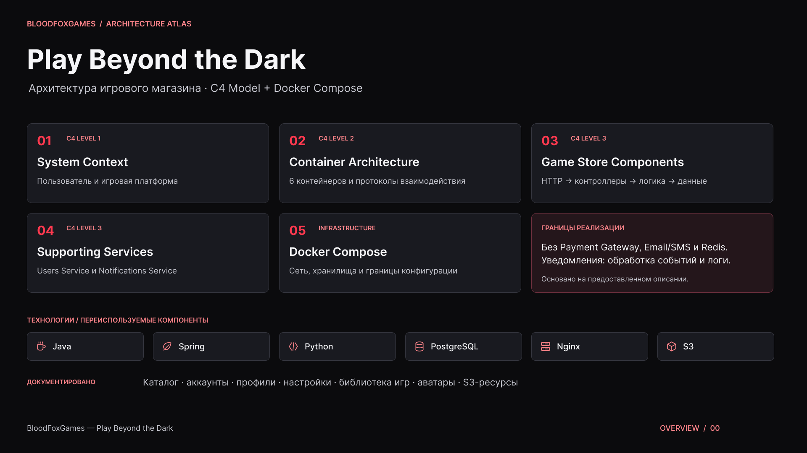
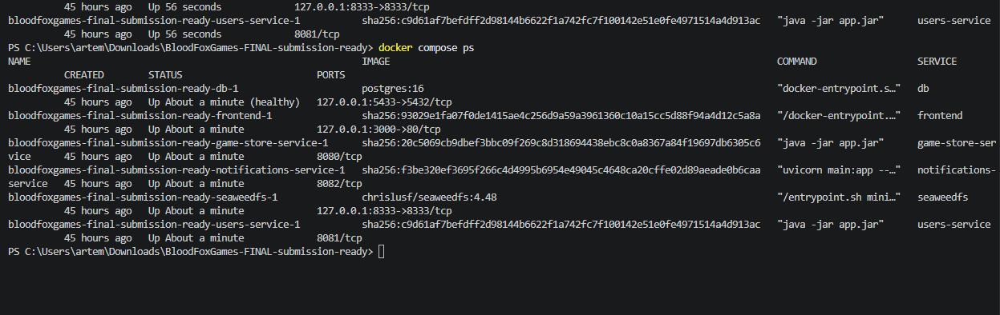
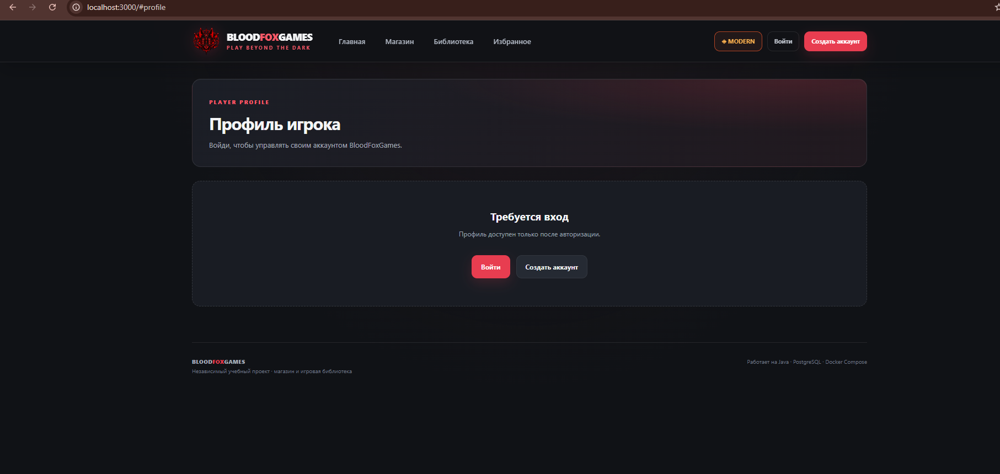

# BloodFoxGames — игровой каталог и библиотека

BloodFoxGames — учебный веб-проект с несколькими микросервисами. Пользователь может зарегистрироваться, войти, просматривать каталог игр, добавлять игры в личную библиотеку, менять профиль и загружать аватар в S3-совместимое хранилище.

> Это функциональный учебный прототип, а не коммерческая платёжная платформа. Покупка демонстрационная: игра добавляется в библиотеку без списания денег.

## Возможности

- Каталог игр, карточки, поиск/сортировка и избранное.
- Регистрация и вход с BCrypt-хешированием пароля.
- Серверная сессия в HttpOnly cookie `BFGSESSION`; идентификатор пользователя не берётся из `localStorage`.
- Профиль: отображаемое имя, никнейм, email, краткое описание и аватар.
- Приватность, предпочтения уведомлений и смена пароля.
- Личная библиотека и демонстрационное добавление игр.
- SeaweedFS с S3-compatible API для хранения файлов; пользовательский аватар выдаётся по короткоживущему signed URL.
- Две темы интерфейса: MODERN и FOXGAME.

## Архитектура и сервисы

## Architecture Overview

The following diagram illustrates the BloodFoxGames system architecture.

<p align="center">
  
</p>

---
| Сервис | Технологии | Ответственность | Порт |
|---|---|---|---:|
| Frontend / Nginx | HTML, CSS, JavaScript, Nginx | UI и proxy `/api/` | `127.0.0.1:3000` |
| Game Store Service | Java 17, Spring Boot, JPA | Каталог, сессии, профиль, библиотека, покупка-демо | `8080` internal |
| Users Service | Java 17, Spring Boot, JPA | Отдельный каталог-проекция пользователей; Game Store синхронизирует ID/username/email по HTTP | `8081` internal |
| Notifications Service | Python, FastAPI | Приём событий и запись их в лог | `8082` internal |
| PostgreSQL | PostgreSQL 16 | Учётные записи, игры, связи библиотеки и каталог пользователей | `127.0.0.1:5432` |
| SeaweedFS | S3-compatible object storage | Bucket `bloodfox-assets`, аватары и файлы | `127.0.0.1:8333` |

Game Store — источник истины для учётных данных и паролей. Users Service хранит отдельную проекцию пользователя по `account_id` для демонстрации взаимодействия микросервисов. При демо-покупке Game Store обращается к Notifications Service. Все сервисы находятся в общей Docker Compose network; внутренние API не публикуются на внешние интерфейсы хоста.

## Архитектура C4


## Server Execution

BloodFoxGames was successfully built and started using Docker Compose.

### Docker Containers

All six application containers are running successfully.
PostgreSQL reports a healthy status.



### Application Interface

The BloodFoxGames frontend is accessible at http://localhost:3000.




Открой `.env` и замени `POSTGRES_PASSWORD`, `S3_ROOT_PASSWORD` и `S3_ADMIN_TOKEN` на длинные уникальные случайные значения. Не используй пароли от других сервисов и не отправляй `.env` в Git. Для локального `http://localhost` оставь `SESSION_COOKIE_SECURE=false`.

```bash
docker compose config --quiet
docker compose up -d --build
docker compose ps -a
```

Открой сайт: **http://localhost:3000**.

Остановка без удаления данных:

```bash
docker compose down
```

Не используй `docker compose down -v`, если нужно сохранить volumes `db_data` и `s3_data`.

## Профиль и аккаунт

1. Зарегистрируй тестовый аккаунт или войди.
2. Открой профиль через меню аккаунта.
3. В блоке профиля измени отображаемое имя, никнейм, email и описание.
4. Загрузи PNG/JPEG/WEBP/GIF не более 5 MiB.
5. Измени настройки приватности/предпочтений.
6. Для смены пароля введи текущий пароль и новый пароль от 12 символов. Текущая сессия будет завершена — войди снова.

Аватар хранится в `bloodfox-assets` в ключе `avatars/{userId}/...`; браузер получает краткоживущую подписанную ссылку. S3 admin token не передаётся во frontend.

## API

Полный список endpoints находится в [api-plan.md](api-plan.md), последовательность проверки — в [docs/api-examples.md](docs/api-examples.md).

Базовые проверки:

```bash
curl -i http://localhost:3000/api/v1/games
curl -i http://localhost:3000/api/v1/storage/health
```

## Тестирование

Frontend:

```bash
cd frontend
npm test
npm run check
```

Backend:

```bash
mvn -f game-store-service/pom.xml test
mvn -f users-service/pom.xml test
```

Интеграционный сценарий (после запуска Compose, из корня проекта):

```bash
scripts/smoke-test.sh
```

Он проверяет каталог, регистрацию/сессию, профиль, настройки, блокировку чужого профиля, библиотеку, HTTP-событие Notifications Service, Users Service directory projection, S3/avatar round-trip и сохранность данных после перезапуска Game Store. Он перезапускает только `game-store-service`; PostgreSQL и SeaweedFS volumes остаются нетронутыми.

GitHub Actions автоматически запускает Node.js, Maven, Python, Compose и интеграционные проверки на push/PR в `main`.

## Известные ограничения

- Реальные платежи, заказы, возвраты и платёжные webhooks не реализованы.
- Notifications Service пока только логирует события; email/push не отправляются.
- Флаги email-уведомлений сохраняются, но реальная доставка писем не настроена.
- Сессии хранятся в памяти одного Game Store процесса; после перезапуска нужно войти снова. Профиль/библиотека сохраняются в PostgreSQL.
- Для production нужно включить HTTPS и `SESSION_COOKIE_SECURE=true`, добавить CSRF/Origin protection, rate limiting, password reset, email verification, 2FA, управление сессиями, Flyway/Liquibase, резервные копии и мониторинг.

## Отправка обновлений в GitHub

Пошаговая инструкция для применения архива поверх существующего Git-репозитория: [UPLOAD_TO_GITHUB.md](UPLOAD_TO_GITHUB.md).

## Защита проекта

См. [чек-лист защиты](docs/DEFENSE_CHECKLIST.md). Скриншоты реальных проверок можно складывать в `docs/evidence/`; не добавляй секреты, cookies или реальные пароли.

## Server Execution

Screenshots demonstrating the successful execution
of the BloodFoxGames backend services.

### Backend Services


### Docker Containers


### Application Interface

